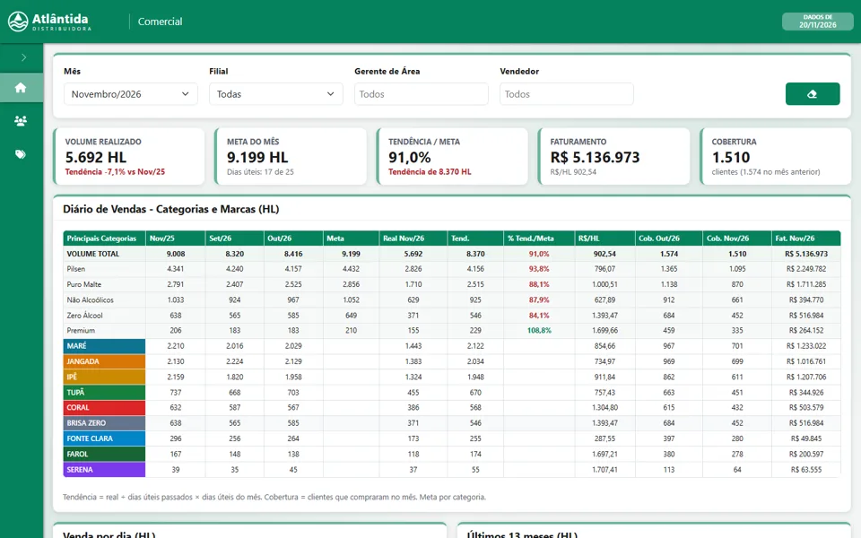

# Portfólio Marlon Amaral — painéis de gestão em Shiny for Python

Telas de um sistema que desenvolvo e mantenho em produção numa distribuidora de bebidas: seis aplicações
(comercial, logística, financeiro, fiscal, monitoramento e acessos). O código de cada tela é o do sistema
real; os dados são **fictícios**, gerados nas mesmas colunas e formatos da produção, com alguns dados
públicos de verdade (IBGE).

**Ver funcionando:** https://biuspoly.github.io/Shiny-Python-Portifolio/

Tudo roda no navegador, sem servidor: os apps são exportados com o
[Shinylive](https://shiny.posit.co/py/docs/shinylive.html), que leva o Python para a página via WebAssembly.
A primeira abertura baixa o ambiente (de 15 a 30 segundos); depois fica no cache.

| | |
|---|---|
|  |  |
|  |  |

## Os apps

| App | Telas |
|---|---|
| **Comercial** | Diário de Vendas (meta, tendência, cobertura e histórico por categoria e produto), Curva ABC de clientes, Mapa Comercial (potencial e cobertura por município sobre a malha e a população do IBGE) |
| **Logístico** | Frota (Geral, Entrada e Saída: débitos, multas, restrições, combustível e mapa), Planilha de Entregas, Devoluções (Detalhes, Caixas, Devoluções e Gráficos) |
| **Financeiro** | Fluxo Financeiro (posição com a fábrica e empréstimos entre revendas, com histórico diário), Empréstimos, Juros, Extratos bancários |
| **Fiscal** | Apuração (ICMS, livro fiscal item a item, PIS/COFINS), Demonstrativo de Faturamento em PDF |
| **Monitoramento** | Visão geral, usuários conectados, erros, desempenho e rotinas, lidos dos logs de telemetria |
| **Acessos** | Acesso por painel, visão geral de uso e histórico de acessos |

O que no sistema real grava em banco ou no ERP (uma justificativa, uma transferência de veículo, a baixa de
um extrato, um acesso) aqui grava na memória da sessão: vale até a página fechar.

## Do sistema real para o portfólio

Cada app é independente, com a sua cópia de `core/` e `www/`, e cada tela é um módulo autossuficiente
(`@module.ui` / `@module.server`) com os próprios filtros, cartões, tabelas e gráficos:

```
<App>/
├── app.py                 menu e páginas
├── requirements.txt       o que o app usa (lido pelo Shinylive)
├── config/                parâmetros de negócio em JSON
├── core/                  peças comuns do app (cores, cartões, tabela paginada, compat do navegador...)
├── pages/<Tela>/
│   ├── pag_<tela>.py      tela e servidor
│   └── Dados/             leitura e regras, sem nada de tela
├── data/                  caches Parquet no formato da produção
└── www/                   CSS, JavaScript, ECharts
```

- **O que mudou em relação à produção**: as integrações. Leitura ao vivo de MySQL, ERP (ODBC) e login saem;
  as consultas passam a ler os caches fictícios. No Acessos, as consultas SQL originais rodam no DuckDB sobre
  tabelas fictícias.
- **O que ficou igual**: layout, componentes, regras de negócio, consultas Polars e DuckDB, gráficos ECharts
  (pyecharts), mapas Folium.

## Os dados

`gerador/` cria tudo a partir de uma semente fixa, no esquema dos caches de produção: quatro revendas
(Natal, Fortaleza, Teresina e São Luís), clientes, produtos de marcas inventadas, frota, títulos, extratos,
livros fiscais, logs e acessos. Os números conversam entre as telas (o livro fiscal item a item soma o
faturamento por CFOP; a planilha de entregas soma as vendas de cada romaneio).

Dados públicos, com cópia em `gerador/cache/` para rodar sem internet:

- **IBGE**: malhas municipais ([API de malhas](https://servicodados.ibge.gov.br/api/docs/malhas)) e população
  do Censo 2022 ([API de agregados](https://servicodados.ibge.gov.br/api/docs/agregados)).
- **Coordenadas dos municípios**: [kelvins/municipios-brasileiros](https://github.com/kelvins/municipios-brasileiros) (MIT).

As datas acompanham o dia em que o gerador roda; toda segunda o GitHub Actions gera tudo de novo e republica
o site.

## Rodar localmente

```bash
python -m venv .venv
.venv/Scripts/activate          # no Linux/Mac: source .venv/bin/activate
pip install -r requirements.txt

python -m gerador.gerar_tudo    # refaz os dados (opcional: eles já vêm no repositório)
cd Comercial && shiny run app.py
```

Para montar o site do Shinylive: `python -m publicar.montar_site` e
`python -m http.server --directory site 8008`.

## Detalhes do Shinylive que valem registro

O Polars do Pyodide (1.18, 32 bits) entra em pânico em casos que no servidor funcionam. Cada app tem um
`core/compat.py` com os contornos:

- `pl.read_parquet` e `DataFrame.write_parquet`: leitura e gravação pelo `pyarrow`;
- `.pl()` do DuckDB e colunas Decimal: o resultado vem por Arrow, com Decimal convertido em Float64;
- `DataFrame.to_pandas()` com texto: a conversão é feita coluna a coluna;
- `str.split()` que gera lista, com alguns milhares de linhas, e `mode()` de texto num `agg`: trocados por
  `split_exact`/`extract` e por contagem.

Também: o tema Flatly vai compilado em `www/css/flatly.min.css` (o navegador não tem o libsass), e o
`requirements.txt` de cada app lista as dependências que o export não descobre sozinho (as do folium, do
fpdf2 e do pyecharts).

---

As revendas, marcas, clientes e pessoas que aparecem nos painéis são fictícios. Nomes de pessoas foram
gerados com o [Faker](https://faker.readthedocs.io/).
