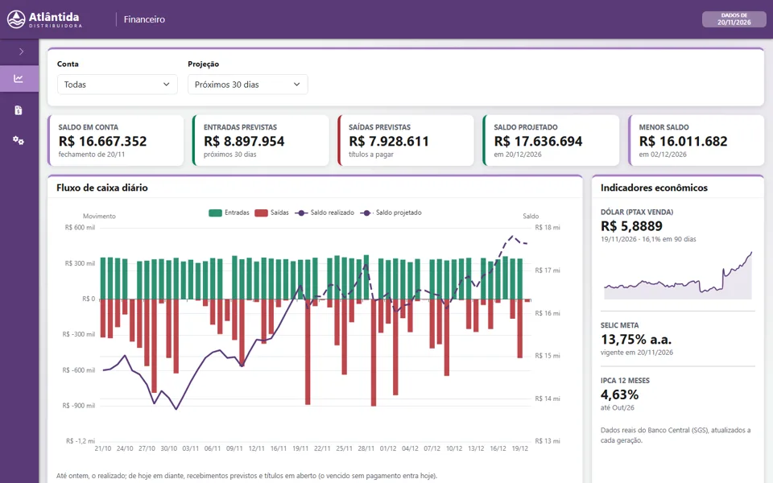
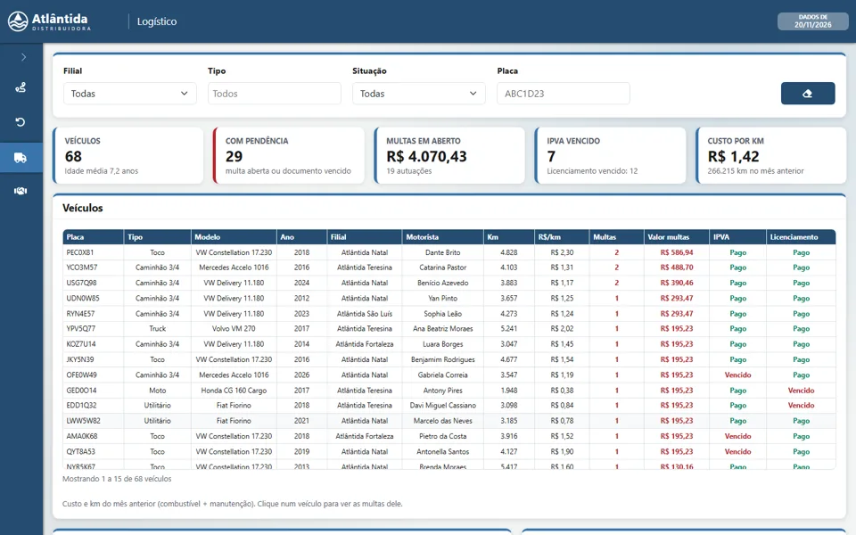
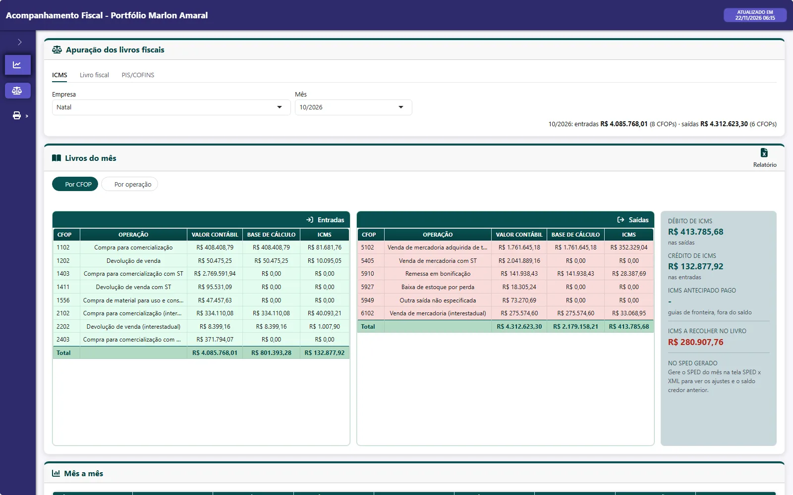

# Atlântida — painéis de gestão em Shiny for Python

Seis aplicações de uma distribuidora de bebidas **fictícia**, a Atlântida, com quatro filiais no Nordeste
(Natal, Fortaleza, Teresina e São Luís). O desenho e a arquitetura vêm de um sistema real que mantenho em
produção; os dados são inventados, com indicadores públicos de verdade.

**Ver funcionando:** https://biuspoly.github.io/Shiny-Python-Portifolio/

Tudo roda no navegador, sem servidor: os apps são exportados com o
[Shinylive](https://shiny.posit.co/py/docs/shinylive.html), que leva o Python para a página via WebAssembly.
A primeira abertura baixa o ambiente (uns 15 segundos); depois fica no cache.

| | |
|---|---|
|  |  |
|  |  |

## Os apps

| App | Páginas |
|---|---|
| **Comercial** | Diário de Vendas (meta, tendência e cobertura por categoria e marca), Carteira de clientes, Mapa Comercial sobre a malha do IBGE, Markup por produto |
| **Logístico** | Romaneios do dia, Devoluções por motivo, Frota (multas, IPVA, custo por km), Comodatos |
| **Financeiro** | Fluxo de caixa realizado e projetado com dólar, Selic e IPCA do Banco Central, Contas a pagar, Conciliação bancária, Farol de fechamento de caixa |
| **Fiscal** | Painel de NF-e, CT-e e NFS-e, Documentos com os itens da nota, Manifestação do destinatário, Escrituração |
| **Monitoramento** | Uso dos painéis, atividade por pessoa, rotinas da madrugada, erros |
| **Acessos** | Papéis, matriz pessoa × página, histórico de alterações |

As ações que no sistema real gravam alguma coisa (manifestar uma nota, mudar um acesso) aqui são simuladas:
valem só para a aba aberta.

## Arquitetura

Os seis apps seguem o mesmo esqueleto; só a paleta de cores muda. Cada um é independente, com a sua cópia de
`core/` e `www/`:

```
<App>/
├── app.py                 menu e páginas
├── requirements.txt       o que o app usa (lido pelo Shinylive e pelo Posit Connect)
├── core/
│   ├── layout.py          cabeçalho, menu lateral recolhível, cartões, filtros, indicadores
│   ├── graficos.py        ponte para o ECharts: o gráfico é um dict montado em Python
│   ├── dados.py           leitura dos Parquet, com cache
│   ├── formato.py         números, moeda e datas no padrão brasileiro
│   └── cores.py           a paleta do app
├── pages/<Página>/
│   ├── pag_<página>.py    tela e servidor (módulo Shiny), autossuficiente
│   └── Dados/dados_<página>.py   consultas em Polars, sem nada de tela
├── data/                  Parquet já agregados
└── www/                   CSS, JavaScript do menu, ECharts, logo, malhas do mapa
```

- **As telas nunca falam com banco de dados**: leem Parquet agregados, com Polars. É o mesmo desenho do
  sistema original, onde um pipeline noturno prepara esses arquivos; aqui quem prepara é o gerador.
- **Gráficos em ECharts** montados como dicionários Python. Formatadores em JavaScript vão como texto com o
  prefixo `js:` e entram crus na página.
- **Cada página é um módulo** (`@module.ui` / `@module.server`) com os próprios filtros, indicadores, tabelas
  e gráficos.

## Os dados

`gerador/` cria a empresa inteira a partir de uma semente fixa: filiais, equipe, 2.080 clientes, produtos de
marcas inventadas, frota e fornecedores. As histórias se cruzam: o mesmo cliente compra no Comercial e recebe
a entrega no Logístico, e cada compra da fábrica vira título a pagar no Financeiro e NF-e com itens e CT-e
no Fiscal. As chaves de acesso têm 44 dígitos com o dígito verificador calculado como na SEFAZ.

Dados públicos, baixados a cada geração (com cópia em `gerador/cache/` para rodar sem internet):

- **IBGE**: malhas municipais do RN, CE, PI e MA ([API de malhas](https://servicodados.ibge.gov.br/api/docs/malhas)).
- **Coordenadas dos municípios**: [kelvins/municipios-brasileiros](https://github.com/kelvins/municipios-brasileiros) (MIT).
- **Banco Central**: dólar PTAX (série 1), Selic meta (432) e IPCA (433) do [SGS](https://dadosabertos.bcb.gov.br/).

As datas acompanham o dia em que o gerador roda; toda segunda o GitHub Actions gera tudo de novo e republica
o site, então os painéis sempre mostram o mês corrente.

## Rodar localmente

```bash
python -m venv .venv
.venv/Scripts/activate          # no Linux/Mac: source .venv/bin/activate
pip install -r requirements.txt

python -m gerador.gerar_tudo    # refaz os dados (opcional: eles já vêm no repositório)
cd Comercial && shiny run app.py
```

Para montar o site do Shinylive: `python -m publicar.montar_site` e
`python -m http.server --directory site 8008`.

## Publicar

- **GitHub Pages** (o que está no ar): `.github/workflows/publicar.yml` confere o código com o Ruff, gera os
  dados, monta o site e publica.
- **Posit Connect Cloud**: cada pasta de app tem `app.py` e `requirements.txt`, então pode ser publicada
  direto do repositório, rodando num servidor de verdade em vez do navegador.

## Detalhes do Shinylive que valem registro

- O `pl.read_parquet` do Polars empacotado no Pyodide (1.18) quebra; a leitura passa pelo `pyarrow` e
  converte com `pl.from_arrow`. O Polars local fica na mesma versão, para não usar nada que não exista lá.
- `mode()` de texto dentro de um `agg` derruba esse Polars; o "motivo mais comum" sai de uma contagem.
- O tema Flatly vai compilado em `www/css/flatly.min.css`: o `ui.Theme("flatly")` precisa do libsass para
  compilar na hora, e o navegador não tem.
- O Shinylive só descobre as bibliotecas pelos imports do `app.py`; o `requirements.txt` de cada app cobre
  as que só aparecem em `core/` e `pages/`.

---

A Atlântida Distribuidora, suas filiais, marcas, clientes e pessoas são fictícios. Nomes de pessoas foram
gerados com o [Faker](https://faker.readthedocs.io/).
