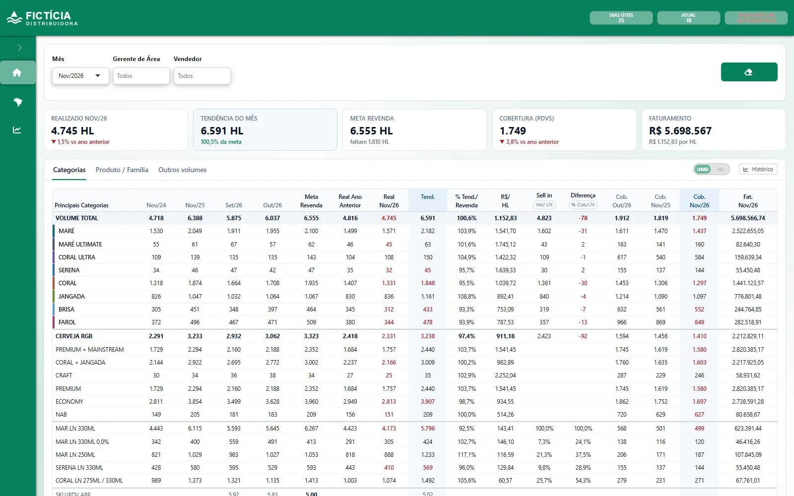
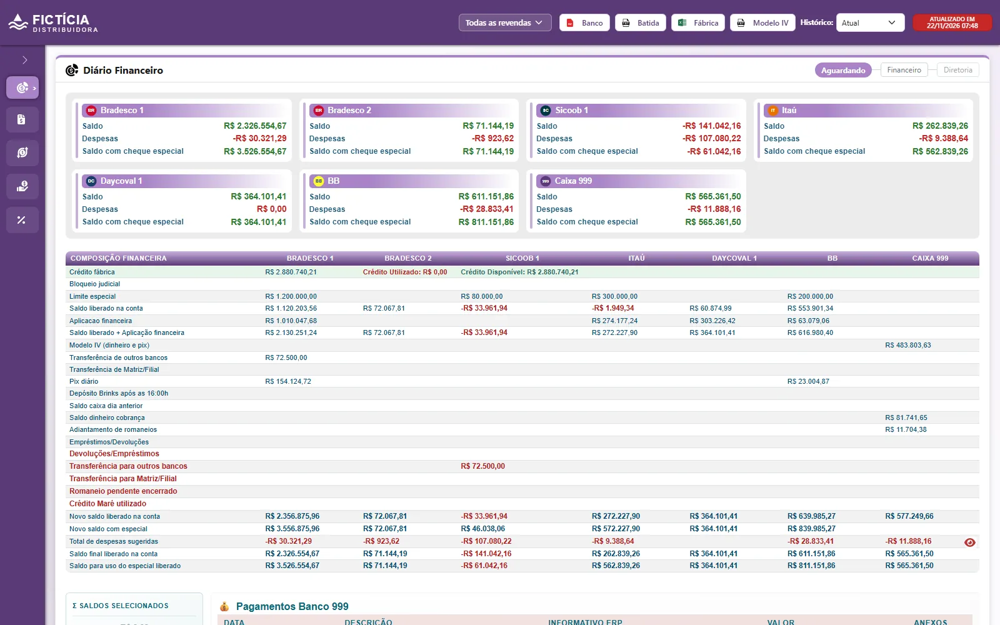
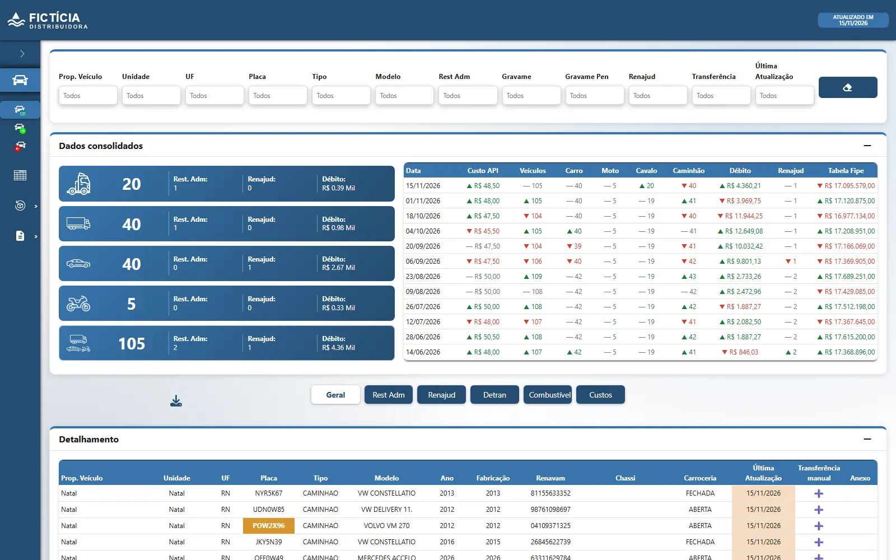
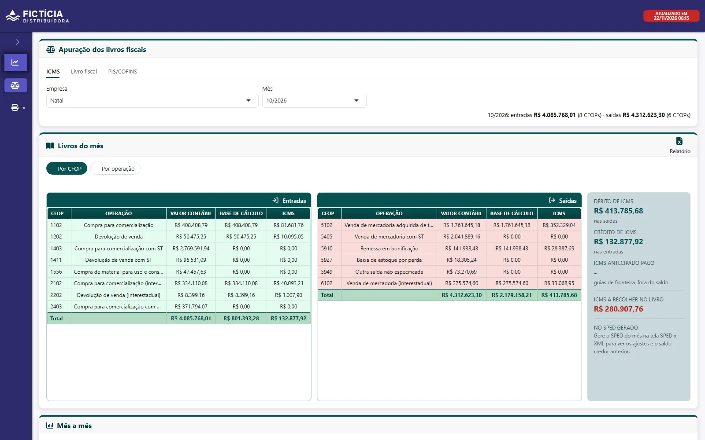

# Portfólio Marlon Amaral — painéis de gestão em Shiny for Python e R Shiny

Telas de um sistema que desenvolvo e mantenho em produção numa distribuidora de bebidas: seis aplicações
(comercial, logística, financeiro, fiscal, monitoramento e acessos) em Shiny for Python, e a versão original
de três delas em R Shiny. O código de cada tela é o do sistema real; os dados são **fictícios**, gerados nas
mesmas colunas e formatos da produção, com alguns dados públicos de verdade (IBGE).

**Ver funcionando:** https://biuspoly.github.io/shiny-portfolio/

| | |
|---|---|
|  |  |
|  |  |

## Organização

```
python/                 Shiny for Python
├── app.py              os seis apps num servidor só (para o Posit Connect Cloud)
├── requirements.txt    as dependências dele (a união das de cada app)
├── Comercial/ Logistico/ Financeiro/ Fiscal/ Monitoramento/ Acessos/
└── Vitrine/            a página de entrada do site
r/                      R Shiny, a versão original
├── app.R               os três apps num servidor só (para o Posit Connect Cloud)
├── manifest.json       as dependências dele
├── Comercial/ Logistico/ Acessos/
└── Vitrine/            o portfólio em bs4Dash
gerador/                os dados fictícios das duas linguagens
publicar/               o site (GitHub Pages) e as dependências do Posit
```

Cada app é independente e roda sozinho (`shiny run python/Comercial/app.py`,
`shiny::runApp("r/Comercial")`).

## Onde roda

- **GitHub Pages**: a vitrine (`python/Vitrine/`, exportada pelo
  [Shinylive](https://shiny.posit.co/py/docs/shinylive.html)) e, pelo Shinylive, cada app que ainda não
  tem endereço no Posit: roda no próprio navegador, e a primeira abertura baixa o ambiente (de 15 a 60
  segundos). O workflow `.github/workflows/publicar.yml` refaz os dados e o site a cada push na `main` e toda
  segunda de manhã.
- **[Posit Connect Cloud](https://connect.posit.cloud/)**: dois conteúdos publicados direto da `main`, um por
  linguagem, com todos os apps dentro.

| | Arquivo principal | Endereços |
|---|---|---|
| Python | `python/app.py` | `/` (página principal), `/comercial/`, `/logistico/`, `/financeiro/`, `/fiscal/`, `/monitoramento/`, `/acessos/` |
| R | `r/app.R` | `/` (página principal), `/?painel=vitrine` (o portfólio em bs4Dash), `/?painel=comercial`, `/?painel=logistico`, `/?painel=acessos` (aceita também `&REVENDA=`) |

Como funcionam os dois apps unificados:

- **Python:** um app Starlette monta cada app Shiny na sua rota e só o carrega no primeiro acesso. Como os
  apps têm pacotes com o mesmo nome (`core`, `pages`) e conteúdo diferente, cada um é importado como um
  pacote próprio (`acomp_comercial`...), e um gancho no `import` manda o `from core...` de cada arquivo
  para o `core` do próprio app, inclusive os imports feitos dentro de funções.
- **R:** o painel vem da URL, como no portal do sistema original. O `app.R` de cada app é avaliado num
  ambiente próprio, com `diretorio` apontando para a pasta dele, e só no primeiro acesso.
- **Dependências:** `python/requirements.txt` e `r/manifest.json` são gerados por
  `python -m publicar.preparar_posit`. Rode depois de mudar as dependências de um app ou de criar/apagar
  arquivo num app em R, e faça commit dos dois; o workflow falha se eles estiverem desatualizados.
- **Dados:** o Posit usa os que estão commitados na `main`. Para atualizá-los, rode
  `python -m gerador.gerar_tudo`, depois `python -m publicar.preparar_posit`, e faça commit.
- **Depois de publicar**, o endereço vai em `acompanhamentos` no `python/Vitrine/enderecos.json`. A vitrine
  passa a abrir cada app pelo Posit, o site deixa de exportá-los pelo Shinylive, e cada subpasta antiga
  (`site/comercial/`, `site/r/comercial/`...) vira uma página que redireciona para o endereço novo.

Para rodar localmente: `shiny run python/app.py` e `shiny::runApp("r")`.

## Os apps

| App | Telas |
|---|---|
| **Comercial** | Diário de Vendas (meta, tendência, cobertura e histórico por categoria e produto), Clientes (carteira: faturamento do mês e de 12 meses, devolução, markup e ativos parados), Markup por produto (real contra o sugerido, com o saldo), Curva ABC de clientes, Mapa Comercial (potencial e cobertura por município sobre a malha e a população do IBGE) |
| **Logístico** | Frota (Geral, Entrada e Saída: débitos, multas, restrições, combustível e mapa), Comodatos (Solicitação, Comodatos e Vasilhames: travas do cliente, pedido ao ERP, documentos do CEV, recolha e distrato), Planilha de Entregas, Devoluções (Detalhes, Caixas, Devoluções e Gráficos) |
| **Financeiro** | Diário Financeiro (saldos dos bancos, composição financeira do dia e Contas a Pagar com auditoria, marcação e envio), Pagamentos, Dados Manuais, Fluxo Financeiro (posição com a fábrica e empréstimos entre revendas, com histórico diário), Empréstimos, Juros, Extratos bancários |
| **Fiscal** | Apuração (ICMS, livro fiscal item a item, PIS/COFINS), Demonstrativo de Faturamento em PDF |
| **Monitoramento** | Visão geral, usuários conectados, erros, desempenho e rotinas, lidos dos logs de telemetria |
| **Acessos** | Acesso por painel, visão geral de uso e histórico de acessos |

O que no sistema real grava em banco ou no ERP (uma justificativa, uma transferência de veículo, a baixa de
um extrato, um acesso) aqui grava na memória da sessão: vale até a página fechar. No Diário Financeiro isso
nem precisou de adaptação: o código de produção já tem um caminho para quando o MySQL está fora do ar
(a gravação vai para um arquivo e uma fila), e no portfólio o banco simplesmente nunca responde.

## A versão original em R

Antes do Python, o sistema existiu em R Shiny (bs4Dash, reactable, DuckDB). Em `r/` estão três desses apps
com o código original: **Comercial** (Diário de Venda e Mapa Comercial; Clientes e Markup foram escritas em R para o portfólio, em versão enxuta), **Logístico** (Frota, Planilha de
Entregas, Devoluções e Comodato) e **Acessos**. Eles são publicados no Posit Connect Cloud (o `r/app.R`) e, enquanto não estão lá, rodam no navegador pelo
[Shinylive para R](https://posit-dev.github.io/r-shinylive/) (webR), em `site/r/`.

A ideia foi mexer o mínimo: as telas são as originais e mudam só as conexões.

- **MySQL → DuckDB em memória.** As tabelas são montadas dos mesmos Parquet fictícios, com os nomes e as
  colunas do MySQL, e as consultas originais (inclusive INSERT e UPDATE) rodam como estão. Um invólucro
  pequeno cuida das diferenças de dialeto: crase vira aspas, `LIKE` vira `ILIKE` e texto compara sem
  diferenciar maiúscula, como no MySQL.
- **ERP (ODBC) → um DuckDB por revenda**, com as tabelas de pedido, CEV, romaneio e nota que os scripts de
  pedido e recolha do comodato leem e gravam.
- **PDF**: o contrato e o distrato eram R Markdown com LaTeX, que o webR não tem; um `render()` substituto
  desenha o documento com o `pdf()` do próprio R.
- **Parquet no navegador**: o `read_parquet` do DuckDB é extensão, indisponível no webR; os arquivos são lidos
  pelo `nanoparquet` e registrados no DuckDB.

Para rodar localmente: `shiny::runApp("r/Logistico")` (com os pacotes instalados e os dados copiados por
`python -m gerador.gerar_tudo`).

## Do sistema real para o portfólio

Cada app é independente, com a sua cópia de `core/` e `www/`, e cada tela é um módulo autossuficiente
(`@module.ui` / `@module.server`) com os próprios filtros, cartões, tabelas e gráficos:

```
<App>/
├── app.py                 menu e páginas
├── requirements.txt       o que o app usa (lido pelo Posit e pelo Shinylive)
├── config/                parâmetros de negócio em JSON
├── core/                  peças comuns do app (cores, cartões, tabela paginada, compat do navegador...)
├── pages/<Tela>/
│   ├── pag_<tela>.py      tela e servidor
│   └── Dados/             leitura e regras, sem nada de tela
├── data/                  caches Parquet no formato da produção
└── www/                   CSS, JavaScript, ECharts
```

- **O que mudou em relação à produção**: as integrações. Leitura ao vivo de MySQL, ERP (ODBC) e login saem;
  as consultas passam a ler os caches fictícios. No Acessos, as consultas SQL originais rodam no DuckDB sobre
  tabelas fictícias.
- **O que ficou igual**: layout, componentes, regras de negócio, consultas Polars e DuckDB, gráficos ECharts
  (pyecharts), mapas Folium.

## Os dados

`gerador/` cria tudo a partir de uma semente fixa, no esquema dos caches de produção: quatro revendas
(Natal, Fortaleza, Teresina e São Luís), clientes, produtos de marcas inventadas, frota, títulos, extratos,
livros fiscais, logs e acessos. Os números conversam entre as telas (o livro fiscal item a item soma o
faturamento por CFOP; a planilha de entregas soma as vendas de cada romaneio).

Dados públicos, com cópia em `gerador/cache/` para rodar sem internet:

- **IBGE**: malhas municipais ([API de malhas](https://servicodados.ibge.gov.br/api/docs/malhas)) e população
  do Censo 2022 ([API de agregados](https://servicodados.ibge.gov.br/api/docs/agregados)).
- **Coordenadas dos municípios**: [kelvins/municipios-brasileiros](https://github.com/kelvins/municipios-brasileiros) (MIT).

As datas acompanham o dia em que o gerador roda; toda segunda o GitHub Actions gera tudo de novo e republica
o site. No Posit ficam os dados commitados na `main`.

## Rodar localmente

```bash
python -m venv .venv
.venv/Scripts/activate          # no Linux/Mac: source .venv/bin/activate
pip install -r requirements.txt

python -m gerador.gerar_tudo    # refaz os dados (opcional: eles já vêm no repositório)
shiny run python/Comercial/app.py   # ou python/app.py (todos) ou python/Vitrine/app.py (a vitrine)
```

Para montar o site do Shinylive: `python -m publicar.montar_site` e
`python -m http.server --directory site 8008`.

## Detalhes do Shinylive que valem registro

O Polars do Pyodide (1.18, 32 bits) entra em pânico em casos que no servidor funcionam. Cada app tem um
`core/compat.py` com os contornos:

- `pl.read_parquet` e `DataFrame.write_parquet`: leitura e gravação pelo `pyarrow`;
- `.pl()` do DuckDB e colunas Decimal: o resultado vem por Arrow, com Decimal convertido em Float64;
- `DataFrame.to_pandas()` com texto: a conversão é feita coluna a coluna;
- `str.split()` que gera lista, com alguns milhares de linhas, e `mode()` de texto num `agg`: trocados por
  `split_exact`/`extract` e por contagem.

Também: o tema Flatly vai compilado em `www/css/flatly.min.css` (o navegador não tem o libsass), e o
`requirements.txt` de cada app lista as dependências que o export não descobre sozinho (as do folium, do
fpdf2 e do pyecharts).

---

As revendas, marcas, clientes e pessoas que aparecem nos painéis são fictícios. Nomes de pessoas foram
gerados com o [Faker](https://faker.readthedocs.io/).
